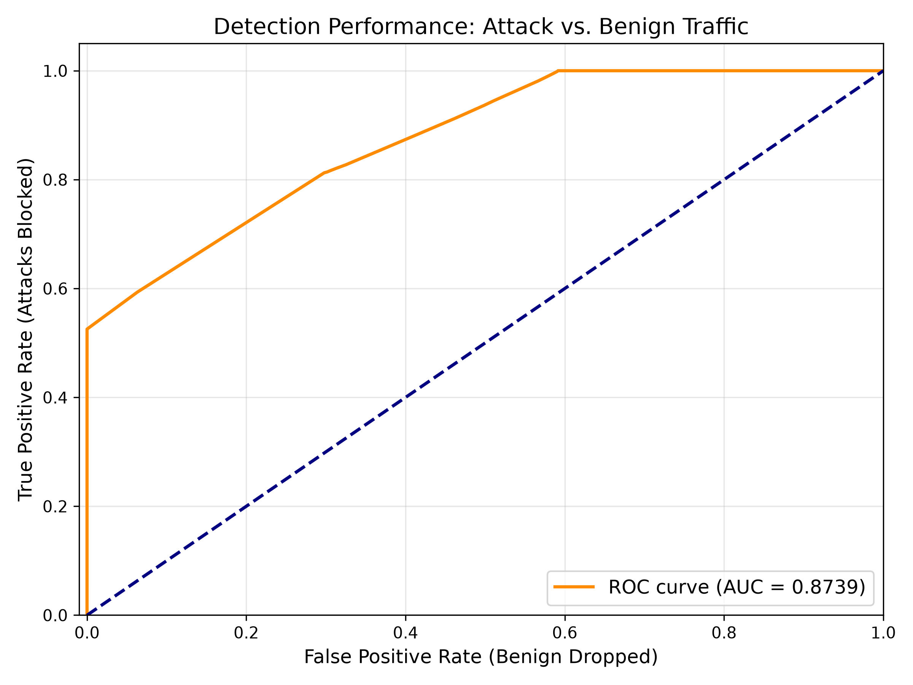
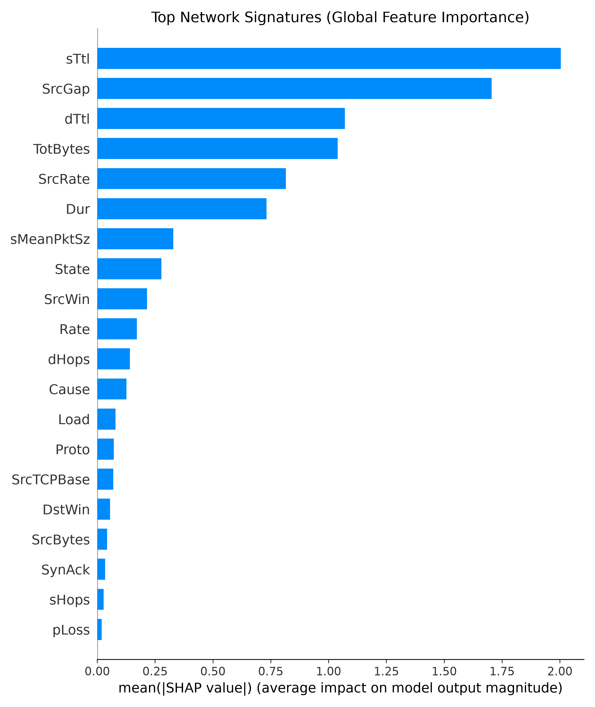
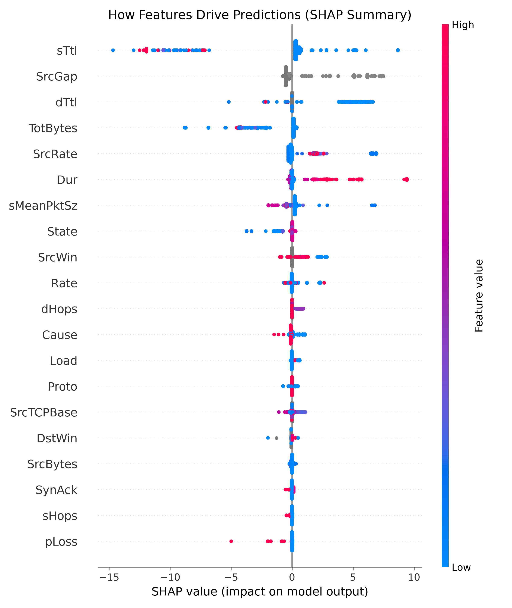

# 🛡️ 5G Intrusion Detection System (IDS)

**A Machine Learning Pipeline for 5G Network Intrusion Detection, Explainability, and Threat Mitigation**

This project implements an end-to-end machine learning workflow for detecting and analyzing cyber threats in 5G network traffic. It covers data preprocessing, class imbalance handling, model training and evaluation, explainable AI using SHAP, threat mitigation, and performance visualization.

<p align="center">
  
  
  
  
</p>

---

## 📑 Table of Contents

- [Overview](#-overview)
- [Project Objectives](#-project-objectives)
- [Pipeline Architecture](#-pipeline-architecture)
- [Repository Structure](#-repository-structure)
- [Visualizations](#-visualizations)
- [Technology Stack](#-technology-stack)
- [Installation and Setup](#-installation-and-setup)
- [Running the Pipeline](#-running-the-pipeline)
- [Dataset Requirements](#-dataset-requirements)
- [Future Enhancements](#-future-enhancements)
- [Disclaimer](#-disclaimer)

---

## 🔍 Overview

The increasing adoption of 5G networks introduces new cybersecurity challenges due to massive device connectivity, high-speed communication, and evolving attack techniques. Detecting malicious activities and anomalous network traffic is essential for improving network security.

This project explores machine learning techniques for identifying potential intrusions in 5G network traffic through a structured, six-phase pipeline.

The workflow progresses from raw data preprocessing to model evaluation, explainability, mitigation analysis, and visualization. It aims to make intrusion detection results easier to evaluate and interpret.

## 🎯 Project Objectives

- **Data Preprocessing:** Clean and prepare network traffic data for machine learning.
- **Class Imbalance Handling:** Address imbalanced class distributions so minority intrusion classes receive appropriate consideration.
- **Model Training:** Train and compare classification models for intrusion detection.
- **Performance Evaluation:** Analyze model performance using evaluation metrics and ROC curves.
- **Explainable AI:** Apply SHAP to understand feature contributions to model predictions.
- **Threat Mitigation:** Explore mitigation strategies informed by intrusion detection insights.
- **Visualization:** Generate plots to support model evaluation and interpretation.

---

## ⚙️ Pipeline Architecture

The project is divided into six modular phases.

| Phase | Script | Description |
|:---:|---|---|
| 1 | `phase1_ingestion.py` | Loads, cleans, and preprocesses the dataset. |
| 2 | `phase2_imbalance.py` | Handles class imbalance in network traffic data. |
| 3 | `phase3_models.py` | Trains and compares machine learning classifiers. |
| 4 | `phase4_explainability.py` | Uses SHAP to interpret model predictions. |
| 5 | `phase5_mitigation.py` | Explores threat mitigation and defensive strategies. |
| 6 | `phase6_visuals.py` | Generates performance and explainability visualizations. |

### 🔄 Workflow

```text
       Network Traffic Dataset
                 │
                 ▼
    ┌──────────────────────────┐
    │ 1. Data Ingestion        │
    │    & Preprocessing       │
    └────────────┬─────────────┘
                 ▼
    ┌──────────────────────────┐
    │ 2. Class Imbalance       │
    │    Handling              │
    └────────────┬─────────────┘
                 ▼
    ┌──────────────────────────┐
    │ 3. Model Training        │
    │    & Evaluation          │
    └────────────┬─────────────┘
                 ▼
    ┌──────────────────────────┐
    │ 4. SHAP Explainability   │
    └────────────┬─────────────┘
                 ▼
    ┌──────────────────────────┐
    │ 5. Threat Mitigation     │
    └────────────┬─────────────┘
                 ▼
    ┌──────────────────────────┐
    │ 6. Visualizations        │
    └──────────────────────────┘
```

---

## 📂 Repository Structure

```text
5G-Intrustion-Detection/
│
├── phase1_ingestion.py
├── phase2_imbalance.py
├── phase3_models.py
├── phase4_explainability.py
├── phase5_mitigation.py
├── phase6_visuals.py
│
├── roc_curve.png
├── shap_bar_chart.png
├── shap_summary_beeswarm.png
│
└── .gitignore
```

### File Descriptions

| File | Purpose |
|---|---|
| `phase1_ingestion.py` | Data loading and preprocessing |
| `phase2_imbalance.py` | Class imbalance handling |
| `phase3_models.py` | Model training and comparison |
| `phase4_explainability.py` | SHAP-based model interpretation |
| `phase5_mitigation.py` | Threat mitigation analysis |
| `phase6_visuals.py` | Visualization generation |
| `roc_curve.png` | ROC curve visualization |
| `shap_bar_chart.png` | SHAP feature importance plot |
| `shap_summary_beeswarm.png` | SHAP summary beeswarm plot |
| `.gitignore` | Excludes specified files from version control |

---

## 📊 Visualizations

The repository includes visual outputs for examining model performance and understanding model predictions.

### 1. ROC Curve

**File:** `roc_curve.png`



The Receiver Operating Characteristic (ROC) curve illustrates the relationship between the true positive rate and the false positive rate across classification thresholds. It can help assess and compare model discrimination performance.

### 2. SHAP Feature Importance

**File:** `shap_bar_chart.png`



The SHAP bar chart summarizes feature importance based on SHAP values, helping identify the input features that contribute to model predictions.

### 3. SHAP Summary Beeswarm Plot

**File:** `shap_summary_beeswarm.png`



The beeswarm plot displays the distribution of feature contributions across predictions. It helps illustrate how feature values influence model outputs.

---

## 🧰 Technology Stack

The project uses Python and machine learning libraries for data processing, model development, explainability, and visualization.

| Technology | Application |
|---|---|
| Python | Core implementation |
| Pandas | Data manipulation and preprocessing |
| NumPy | Numerical operations |
| Scikit-learn | Machine learning and evaluation |
| TensorFlow / Keras | Deep learning, if used by the implementation |
| SHAP | Model explainability |
| Matplotlib / Seaborn | Data visualization, where used |

The exact packages required depend on the imports and implementations in the individual scripts.

---

## 🚀 Installation and Setup

### Prerequisites

- Python installed on your system.
- Git installed on your system.
- Access to the dataset required by the pipeline.
- The Python dependencies used by the project.

### Step 1: Clone the Repository

```bash
git clone https://github.com/NAKAIT777/5G-Intrustion-Detection.git
cd 5G-Intrustion-Detection
```

### Step 2: Create a Virtual Environment

**Windows**

```bash
python -m venv venv
venv\Scripts\activate
```

**Linux / macOS**

```bash
python3 -m venv venv
source venv/bin/activate
```

### Step 3: Install Dependencies

If a `requirements.txt` file is added to the repository, install the dependencies with:

```bash
pip install -r requirements.txt
```

Otherwise, install the packages required by your scripts. For example:

```bash
pip install pandas numpy scikit-learn matplotlib seaborn shap tensorflow
```

Install TensorFlow and Seaborn only if your implementation requires them. Ensure the selected package versions are compatible with your Python environment.

---

## ▶️ Running the Pipeline

Execute the scripts from the repository's root directory, following the pipeline's intended order.

**Phase 1 — Data Ingestion and Preprocessing**

```bash
python phase1_ingestion.py
```

**Phase 2 — Class Imbalance Handling**

```bash
python phase2_imbalance.py
```

**Phase 3 — Model Training and Comparison**

```bash
python phase3_models.py
```

**Phase 4 — Explainable AI**

```bash
python phase4_explainability.py
```

**Phase 5 — Threat Mitigation**

```bash
python phase5_mitigation.py
```

**Phase 6 — Visualization Generation**

```bash
python phase6_visuals.py
```

> **Note:** Each phase may depend on data or outputs generated by earlier phases. Verify the input paths and execution order defined in the scripts before running the complete pipeline.

---

## 📁 Dataset Requirements

The project uses `Combined.csv` as its primary dataset, as described in the project configuration.

Because the dataset is too large to include in the GitHub repository, it is excluded through `.gitignore`.

Before running the pipeline:

1. Obtain the dataset from its authorized source.
2. Place `Combined.csv` in the location expected by `phase1_ingestion.py`.
3. Verify that the dataset columns and format match the preprocessing logic.
4. Confirm that the file is accessible before executing the pipeline.

**Important:** The dataset is not included in this repository. Add the original dataset source or instructions for obtaining access if permitted.

---

## 🔮 Future Enhancements

Potential directions for extending the project include:

- **Real-Time Intrusion Detection:** Integrate network traffic streaming for continuous monitoring.
- **Advanced Deep Learning Models:** Explore LSTM and Transformer-based architectures for temporal attack pattern analysis.
- **Interactive Monitoring Dashboard:** Visualize detection results, traffic patterns, and model performance through a dashboard.
- **Enhanced Evaluation:** Compare models using precision, recall, F1-score, confusion matrices, and other suitable metrics.
- **Automated Alerting:** Explore integrations that notify operators about suspicious network activity.
- **Deployment:** Evaluate the pipeline in realistic test environments to understand its practical limitations.

---

## ⚠️ Disclaimer

This project is intended for educational and research purposes. Its effectiveness depends on the dataset, preprocessing methods, model configuration, and evaluation methodology. The system should be thoroughly validated before any consideration for operational network security use.

---

<p align="center">
  <b>🛡️ Machine Learning for 5G Network Security</b>
  <br>
  <sub>Detect • Analyze • Explain • Improve</sub>
</p>
